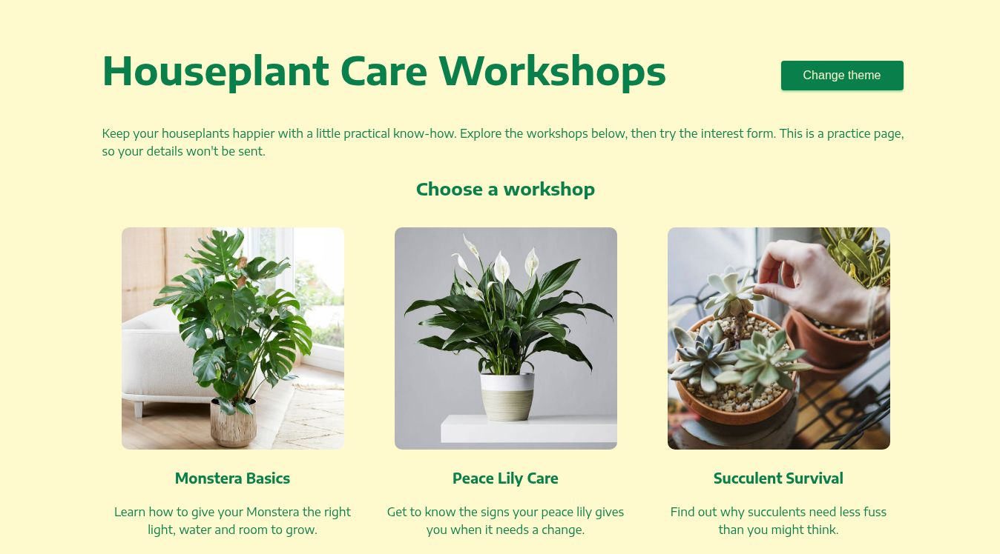
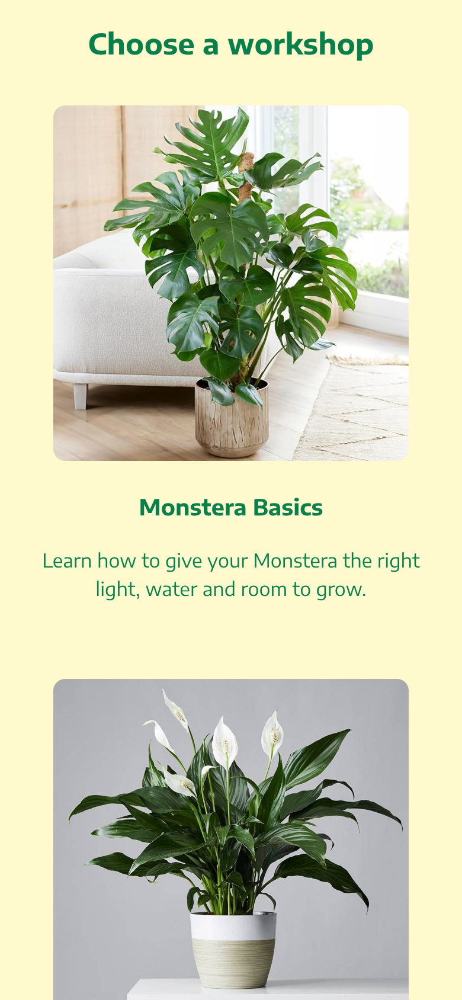
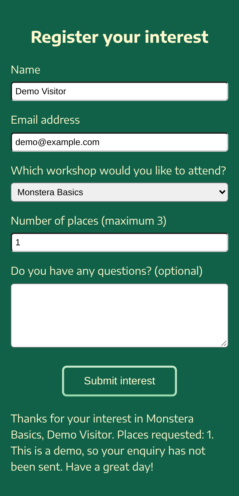

# Houseplant Care Workshops

A responsive landing page for three houseplant care workshops, with light and dark themes and a demo interest form. I built it to practise responsive layouts, keyboard focus styles and browser-side form validation.

**[Try the live demo](https://houseplant-care-workshops.netlify.app/)**

## Try the demo

1. Browse the workshop cards and use **Change theme** to switch between light and dark.
2. Submit the form with a required field blank or an invalid email to see the browser’s validation.
3. Try again with sample details. Select a workshop and request one to three places. The page shows a confirmation with the workshop and number of places.

The form runs in the browser. Entries are used to show the demo confirmation and are never sent to a server.

## Mobile views at 390px

| Workshop cards | Interest form |
| --- | --- |
|  |  |

## How it works

- **Responsive layout.** CSS Grid displays the cards in three columns on wide screens, two on narrower screens and one on phones.
- **Theme toggle.** JavaScript toggles a class on the page to apply the dark theme. Both themes have visible keyboard focus styles on buttons and form controls.
- **Form validation and feedback.** HTML handles required fields, email format and the one-to-three-place limit. JavaScript stops the form from navigating away, shows the confirmation in a status area that assistive technology can announce, and clears it when the form changes.

## Run locally

Clone or download the repository and open `index.html` in a browser. The project uses plain HTML, CSS and JavaScript, with no build step.

| File or folder | Purpose |
| --- | --- |
| `index.html` | Workshop cards, interest form and confirmation area |
| `src/styles.css` | Layout, responsive breakpoints, themes and focus styles |
| `src/script.js` | Theme switching and form feedback |
| `src/img/` | Workshop photographs |
